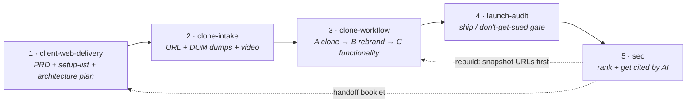

# Client Site Pipeline

**An opinionated, end-to-end workflow for cloning a website into a client-ready
build and shipping it without surprises — packaged as six composable
[Claude Code](https://docs.anthropic.com/en/docs/claude-code) / Agent SDK skills.**

The pipeline takes a project from *"here's a template I like"* to *"it's live and
ranking"* in five ordered steps. Each step is a self-contained skill that
produces a concrete artifact the next step depends on. Skip a step and the next
one tells you what's missing.

<sub>Skills: 6 · Steps: 5 · Zero runtime dependencies · Works with Claude Code and the Claude Agent SDK</sub>

---

## Why this exists

Cloning a site and rebranding it for a client is deceptively easy to do *badly*.
The common failure modes are always the same:

- The "clone" quietly becomes a redesign — new class names, a `clamp()` type
  scale, brand colors swapped in before the layout was ever verified.
- Facts get invented — a phone number, a review, a price, opening hours — and
  nobody notices until the client does.
- The site ships with an empty view-source, no privacy policy, fabricated
  testimonials, or a `robots.txt` that blocks the crawlers that matter.
- SEO is treated as a launch checkbox instead of the practice it is, and a
  rebuild silently drops the rankings the old site had.

This pipeline encodes the guardrails for each of those into a step that has to
pass before the next one starts.

---

## The pipeline

| # | Skill | Runs | Done when |
|---|-------|------|-----------|
| **1** | [`client-web-delivery`](skills/client-web-delivery/SKILL.md) | Start of the job | An approved **PRD** captures the site's intent (who buys, what they must believe, the one action that makes money); a **setup-list** exists; every client fact lives in **one** `src/data/` file; an **architecture-plan** exists and every service has a reason; nothing invented |
| **2** | [`clone-intake`](skills/clone-intake/SKILL.md) | Before any clone build | Live template **URL** + repo `.txt` DOM dumps (scrolled to each section) + a **motion video** — or a written note of what's missing |
| **3** | [`clone-workflow`](skills/clone-workflow/SKILL.md) | After intake passes | Template cloned at fidelity **(Phase A)**, *then* rebranded from the data file only, mapped to the PRD section by section by a senior room (strategist, copywriter, art director, UX lead) from a media-truth inventory, until the first screen sells to the target buyer with real proof, built from the template's own design grammar **(Phase B)**, *then* only the functionality in the architecture plan is connected **(Phase C)**, including the **live showcase standard** (signup that saves to D1, cookie banner that gates analytics, matching privacy page, a second language) |
| **4** | [`launch-audit`](skills/launch-audit/SKILL.md) | On the production build, before go-live | Real SSR view-source, custom 404, unique titles, OG image, JSON-LD, canonical, AI-crawler-friendly `robots.txt`, sitemap, alt text, **no secrets**, a real privacy policy, a signup that saves a row, a banner that gates analytics, every enabled conversion proven end to end, **no fabricated testimonials** |
| **5** | [`seo`](skills/seo/SKILL.md) | After launch (snapshot old URLs *before* step 3 on a rebuild) | Crawlable HTML, GBP / NAP consistent if local, no stray `noindex`, redirects in place if replacing an old site |



The orchestrator skill — [`client-site-pipeline`](skills/client-site-pipeline/SKILL.md) —
is what an agent reads first. It enforces the order, names the current step out
loud, and refuses to skip ahead.

---

## The skills

### 1 · `client-web-delivery` — intake & handoff
A repeatable five-stage workflow for shipping a client site. It starts from a
**PRD** (read if supplied, never overwritten; drafted from
[`assets/prd-template.md`](skills/client-web-delivery/assets/prd-template.md)
otherwise) that records the site's business intent. Its signature
artifacts are the **setup-list** (everything you need *from* the client) and
the **architecture-plan** (the smallest stack that requirement actually needs:
Astro, Cloudflare static or Worker, database none / Supabase / Convex, auth,
R2 only for post-launch uploads). After SEO it runs once more to write
`deliverables/client-handoff.md`. Ships with templates in
[`assets/`](skills/client-web-delivery/assets/).

### 2 · `clone-intake` — the gate in front of cloning
A checklist. A DOM dump is a photo of one frozen moment — it carries no fonts,
no motion, no hover states. The live URL carries the real source; the video
carries the animation. This step refuses to start a clone until it has all
three, or an explicit note of what will be guessed without them.

### 3 · `clone-workflow` — clone, then rebrand, then connect — as verified phases
The core skill. **Phase A**: port the fetched source *close to verbatim* — same
class names, same CSS values, the template's own colors, fonts, copy and
images — at a clearly separate route, and verify it against the screenshot and
video section by section. **Phase B**: only then, swap content — copy, images,
links, logo, brand colors — with each section mapped to the PRD's intent in
`section-purpose-map.md` and any addition built from the template's own
buttons, fonts, spacing and section patterns
([`references/intent-aware-rebrand.md`](skills/clone-workflow/references/intent-aware-rebrand.md)).
It never restructures layout inherited from Phase A without approval.
**Phase C**: only then, connect what `architecture-plan.md` selected. Wiring a
form is not permission to redesign the card. Also covers reading motion out of
a video with `ffmpeg` contact sheets, and content-integrity rules for the
rebrand.

### 4 · `launch-audit` — ship / don't-get-sued gate
Runs on the **production build**, not the dev server. Two halves: technical
ship-readiness (non-empty view-source, 404, titles, OG, schema, canonical,
robots, sitemap, `lang`, alt text, no exposed source maps or secrets) and
legal (a privacy policy that discloses data collection + AI use + third-party
processors; testimonials that are actually real). Ships with
[`scripts/audit.sh`](skills/launch-audit/scripts/audit.sh).

### 5 · `seo` — growth after launch
Full SEO / local SEO / GEO-AEO practice across the three surfaces that now
matter equally: classic search, "near me" / Google Business Profile, and being
cited by AI assistants. Detailed references for
[technical](skills/seo/references/technical.md),
[schema](skills/seo/references/schema.md),
[content](skills/seo/references/content.md),
[links](skills/seo/references/links.md),
[local](skills/seo/references/local.md),
[GEO/AEO](skills/seo/references/geo-aeo.md) and
[measurement](skills/seo/references/measurement.md), plus a
[`google-index.js`](skills/seo/scripts/google-index.js) helper.

---

## Operating principles

These run through every skill:

- **One source of truth for facts.** Phone, address, hours, prices, ordering
  URLs — one `src/data/` file, never inline in components.
- **Never invent a fact.** No fabricated prices, reviews, credentials, results,
  or hours. Placeholder + a line on the setup-list instead.
- **Intent before content.** The PRD says who buys and what action makes the
  business money; Phase B places content to serve that, not at random.
- **Clone before you rebrand, and verify in between.** Reinterpreting a template
  into your own component library is a redesign, even when you're trying to be
  faithful.
- **Secrets never travel over chat.** The client pastes credentials into their
  own dashboard or a vault; code references env vars.
- **Smallest architecture that works.** Astro stays. New sites default to
  Cloudflare. No database, login, or R2 unless a real requirement needs it.
  Every selected service has a written reason.
- **Green build → push → verify the live URL.** Never "push and hope."
- **Disclose AI use.** Label AI or stock imagery as illustrative, not real
  outcomes.

---

## Install

The skills are plain folders with a `SKILL.md`. Drop them where your agent looks
for skills.

### Claude Code

```bash
# from a clone of this repo
./install.sh            # macOS / Linux  → ~/.claude/skills/
```

```powershell
# Windows PowerShell
./install.ps1           # → $HOME\.claude\skills\
```

Or copy by hand:

```bash
cp -r skills/* ~/.claude/skills/
```

Project-scoped instead of global? Copy into `.claude/skills/` inside the repo
you're working in.

### Claude Agent SDK

Point your skills directory at `skills/`, or copy the folders into the location
your SDK setup scans. Each skill is self-describing via its `SKILL.md`
frontmatter (`name`, `description`) — no registration step.

---

## Usage

Once installed, an agent invokes them by name. The natural entry point is the
orchestrator:

```
/client-site-pipeline
```

or just describe the job — *"start the clone workflow for this client"* — and
the agent will pick up `client-site-pipeline`, then work through
`client-web-delivery` → `clone-intake` → `clone-workflow` → `launch-audit` →
`seo`, one step at a time, in order.

---

## Repo layout

```
skills/
  client-site-pipeline/   orchestrator — read first, enforces the order
  client-web-delivery/    step 1 — intake, setup-list, architecture plan, handoff
    assets/prd-template.md
    assets/setup-list-template.md
    assets/architecture-plan-template.md
    assets/client-handoff-template.md
    assets/client-handoff-visual-prompt-template.md
  clone-intake/           step 2 — the gate in front of cloning
  clone-workflow/         step 3 — clone (A), rebrand (B), connect (C)
    references/intent-aware-rebrand.md
  launch-audit/           step 4 — ship / don't-get-sued gate
    scripts/audit.sh
  seo/                    step 5 — SEO / local / GEO-AEO
    references/*.md
    scripts/google-index.js
install.sh · install.ps1  copy skills into your agent's skills directory
CONTRIBUTING.md           how the skills are structured and edited
CHANGELOG.md
```

---

## License

Proprietary — see [LICENSE](LICENSE). All rights reserved.
